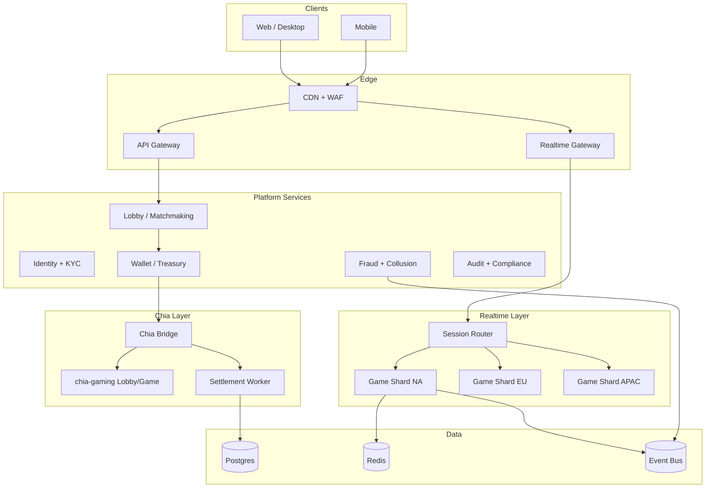

# Architecture

## Design principles

1. **Off-chain speed, on-chain trust** — Betting actions run on authoritative game servers (single-digit ms). Value custody, session open/close, and disputes use Chia.
2. **Event-sourced hands** — Every action is an append-only event with monotonic `seq` for replay, audit, and settlement proofs.
3. **Hybrid Chia modes** — Every variant's heads-up play uses a [chia-gaming](https://github.com/Chia-Network/chia-gaming) state channel. The stake is DAT, never XCH. Three or more players use the DAT table vault and co-sign each hand. A ring, Sit & Go, or tournament table promotes to that same channel when two players remain.
4. **Regional scale-out** — Game shards per geography; global control plane for identity, lobby, and treasury.

## Logical components

## Game loop (ring / MTT)

1. Player joins table via API; buy-in reserved in platform ledger (future: on-chain escrow).
2. Hand starts → server publishes `commitHash` before deal.
3. Players submit entropy seeds → server reveals seed, shuffles, deals.
4. Actions validated by `game-engine`; events broadcast via gateway.
5. Showdown → engine computes winners; settlement worker builds `SettlementProof` and optionally anchors on Chia.

## Game loop (head-to-head, every variant)

1. Two seated players open a DAT chia-gaming session (`/ws/game` relay, XCH wager 0).
2. Players connect wallets (WalletConnect). DAT bonds are the stake.
3. Calpoker moves can use the upstream referee. Other variants play on the DAT POKER engine; the channel carries the co-signed result.
4. Session close pays DAT. XCH is a network fee only.

## Game loop (3+ players, ring / Sit & Go / tournament table)

1. Seats lock DAT in the table vault.
2. The engine deals and validates the hand.
3. Every seated player co-signs the resulting stack vector. That vector is the fallback if a later signature is withheld.
4. When the table shrinks to two players, the vault freezes and the match continues as a chia-gaming heads-up session.

## Trust model

| Concern | Mechanism |
|---------|-----------|
| Deck fairness | Commit-reveal + player seeds + deterministic shuffle |
| Action integrity | Server-authoritative with signed client intents (future) |
| Payout correctness | Settlement proofs + optional on-chain referee (chia-gaming) |
| Collusion | Behavioral ML, device graph, table isolation (planned) |

## Repository mapping (current vs planned)

| Component | Status |
|-----------|--------|
| `packages/game-engine` | MVP NLHE + evaluator |
| `packages/chia-bridge` | Lobby HTTP adapter + settlement hashes |
| `services/api` | Table CRUD, variants |
| `services/gateway` | WS scaffold |
| Postgres / Redis / Kafka | Planned |
| Mobile / Web UI | Planned |
| KYC / AML | Planned |
