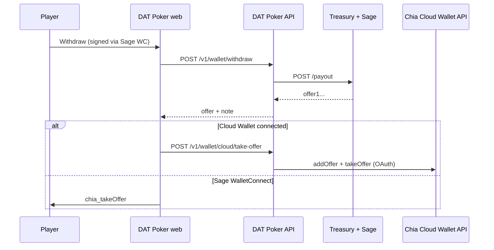

# WITHDRAW DAT (Chia Cloud Wallet)

Treasury **Sage** still builds the DAT payout offer (`offer1…`). **Chia Cloud Wallet** is only where that offer is delivered to the player (`addOffer` + `takeOffer` via OAuth).

WalletConnect + Sage remain the path for buy-in and optional Sage `takeOffer`. Cloud Wallet connect stays **off** in the API and web app until OAuth is registered and `CHIA_CLOUD_WALLET_CLIENT_ID` is set on the game/API host.

## Register the OAuth app

In [Chia Cloud Wallet](https://vault.chia.net/) (mainnet) open **Settings → OAuth Apps** and create an application.

- New apps may stay **pending** until Cloud Wallet approves them. Until approval, authorization fails for players.
- Register this **redirect URI exactly** (production):

  `https://datspiritpoker.com/v1/wallet/cloud/callback`

- **Scopes** (space-separated in the portal, requested together at authorize time):

  `wallet.read`, `offer.read`, `offer.accept`, `offline_access`

Local development can register an additional redirect URI such as  
`http://localhost:4000/v1/wallet/cloud/callback` and set `CHIA_CLOUD_WALLET_REDIRECT_URI` to match.

## API host environment

On the **game/API** machine (not the treasury host), set in `.env`:

| Variable | Required | Notes |
|----------|----------|--------|
| `CHIA_CLOUD_WALLET_CLIENT_ID` | Yes | From OAuth Apps after approval |
| `CHIA_CLOUD_WALLET_CLIENT_SECRET` | Only if issued | Stays on the server only; never expose to the public website |
| `CHIA_CLOUD_WALLET_REDIRECT_URI` | Production | Default dev: `http://localhost:4000/v1/wallet/cloud/callback` |
| `CHIA_CLOUD_WALLET_AFTER_CONNECT_URL` | Optional | Where users land after OAuth (default `http://localhost:5173/`) |
| `CHIA_CLOUD_WALLET_COOKIE_SECURE` | Production | Set `true` when the site is HTTPS-only |

Treasury payout is unchanged: `DAT_TREASURY_PAYOUT_URL` still points at the treasury service that calls Sage `make_offer`. See [TREASURY.md](./TREASURY.md).

## Player flow

1. **Connect** — `GET /v1/wallet/cloud/connect` (browser redirect to Cloud Wallet consent).
2. **Callback** — `GET /v1/wallet/cloud/callback` exchanges the code and sets an HTTP-only session cookie.
3. **Withdraw** — same table cash-out as today; when the response includes an `offer`, the web app calls `/v1/wallet/cloud/take-offer` if Cloud Wallet is connected.

## API routes

| Method | Path | Purpose |
|--------|------|---------|
| GET | `/v1/wallet/cloud/connect` | Start OAuth (`?json=1` returns `authorizeUrl` for debugging) |
| GET | `/v1/wallet/cloud/callback` | OAuth redirect target (must match registered URI) |
| GET | `/v1/wallet/cloud/session` | Connection status + READY vaults |
| POST | `/v1/wallet/cloud/wallet` | Persist selected vault id |
| POST | `/v1/wallet/cloud/take-offer` | Import and take treasury offer string |
| POST | `/v1/wallet/cloud/disconnect` | Revoke tokens and clear session |

`/v1/wallet/config` exposes `cloudWallet: null` until `CHIA_CLOUD_WALLET_CLIENT_ID` is configured.

## References

- [Chia Cloud Wallet API](https://vault.chia.net/docs)
- [TREASURY.md](./TREASURY.md) — Sage treasury offer creation
- [WALLETCONNECT.md](./WALLETCONNECT.md) — Sage buy-in / optional Sage withdraw